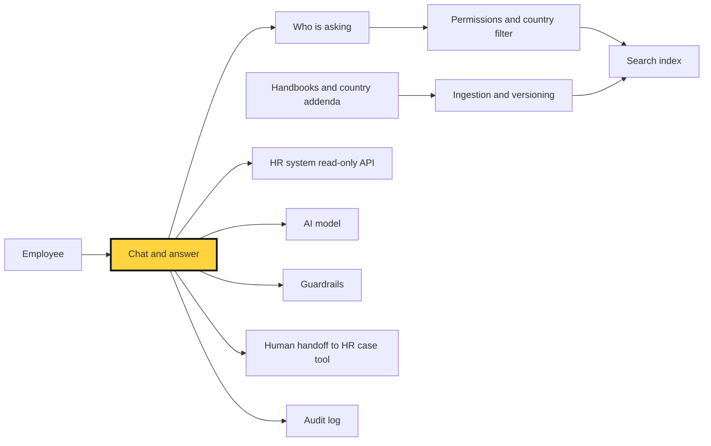

# Lesson 1.1: Framing The Brief (course companion)

Module 1: Enterprise RAG Architecture. Not for LinkedIn.

## Learning objective

After this lesson, you can turn a one-line AI assistant brief into a list of hidden requirements, sort every question type by where its answer lives, and explain why the demo is the smallest part of the system.

## The story

The LinkedIn write-up is [01-curtain-raiser.md](01-curtain-raiser.md): a two-week demo answers "How many days of annual leave do I get?" perfectly, then falls over on six questions nobody asked during the demo. The running example for this whole module is an HR policy and benefits assistant for a 20,000-person global company, with PDF handbooks, country-specific laws, salary ranges, and private employee data.

## Deep dive

### The requirement driving the decision

The brief is one sentence. It hides four requirements:

1. **Correct for the person asking.** The same question has different right answers in Germany and the US, for full-time and part-time staff, for managers and individual contributors.
2. **Current.** Policies change. An answer from last year's handbook is wrong, even if it is quoted perfectly.
3. **Private.** Some documents (salary ranges) and all personal records (leave balance, pay, medical leave) must only reach the people allowed to see them. The questions themselves are sensitive too.
4. **Safe to be unsure.** Some questions are close to legal advice or involve distress. The assistant must know when to stop and hand over to a human.

Remember the hotel front desk from the article. The demo is the receptionist answering "What time is breakfast?". Each of these four requirements is a piece of the back office: the guest register (who is asking), the noticeboard (what is current), the key cabinet (who may see what), and the duty manager (when to hand over).

The single most useful exercise at this stage is to sort questions by **where the answer lives**:

| Where the answer lives | Example question | What the system needs |
|---|---|---|
| A shared document | "What is the parental leave policy?" | Search over handbooks, with citations |
| A document that depends on who you are | "How much annual leave do I get in Germany?" | Search filtered by country, contract type, and grade |
| A restricted document | "What is the salary range for this grade?" | Permission checks before search, not after |
| A private record | "How many leave days do I have left?" | A read-only call to the HR system, made as that employee |
| A human | "Can I be dismissed for sick leave during probation?" | A clean handoff to an HR case, with the conversation attached |

Only the first row is the demo. The other four rows are the project.

### What sits under the waterline



The yellow box is what a two-week demo builds. Everything else is what survives a launch to 20,000 people.

### Three ways to build it

**Option A: Buy or switch on a ready-made assistant.** Many HR platforms and workplace suites now offer a built-in assistant, for example in tools such as Workday, SAP SuccessFactors, or ServiceNow HR Service Delivery [CHECK: current feature coverage and permission model for each].

**Option B: One shared search index plus a model.** Load every handbook into one index (a vector database such as pgvector, Qdrant, or Pinecone), retrieve the closest passages, and let a model write the answer. This is the classic "retrieval-augmented generation" setup, and it is what most demos are.

**Option C: A context-aware and permission-aware assistant.** An orchestrator first works out who is asking (from the company sign-in), filters search by country, contract, and access rights, calls the HR system for personal data, and hands off to a human when it should.

| Option | Good at | Bad at | Pick it when |
|---|---|---|---|
| A: Ready-made assistant | Fast start, permissions already wired to the HR platform, vendor handles upkeep | Limited control over answers, testing, and tone; may not read your own PDFs well; lock-in | Most questions are about data already inside that HR platform |
| B: One shared index | Quick to build, cheap, easy to explain | Ignores who is asking, mixes countries and old versions, can leak restricted text | One country, one handbook, no restricted documents |
| C: Context and permission aware | Right answer per person, respects access, can use live HR data | More moving parts, needs identity and HR system integration, more testing | Many countries, restricted content, personal questions (this brief) |

### The choice and why

Option C, built in stages. Start with B's simplicity but with **who is asking** wired in from day one, and limit the first release to documents everyone may read, in a handful of large countries. Add restricted documents, personal data calls, and more countries one at a time, each with its own tests. The reason is simple: retrofitting identity and permissions into a search index that was built without them usually means rebuilding the index.

### What would change my mind

- **One country, one handbook, nothing restricted.** Then B is enough, and C is over-engineering.
- **The HR platform's own assistant covers most questions and respects its permission model.** Then A wins. Buy, don't build, and spend the effort on testing.
- **Legal says personal records must never pass through the model.** Then drop the HR system calls. The bot answers policy questions only and links to the HR portal for "my balance" questions.

### Failure modes

| Failure | What the employee sees | Root cause | Designed in write-up |
|---|---|---|---|
| Wrong country | German employee told the global 20-day rule | No country filter on search | 5 |
| Stale answer | Old leave figure, quoted with a confident citation | Superseded documents still in the index | 10 |
| Leak | Salary range shown to someone not allowed to see it | Permissions checked after search, or not at all | 6 |
| Made-up personal answer | "You have 20 days left" read from a policy, not a record | No route to live HR data | 2, 3 |
| Overreach | Something close to legal advice, stated as fact | No scope limits or human handoff | 2, 8 |
| Silent drift | Quality drops after a policy or model change, nobody notices | No regular answer testing | 9 |

### A note on regulation

The EU AI Act lists some AI systems used in employment and worker management as high-risk (Annex III). A policy question-and-answer assistant probably sits outside that list, but if it starts to influence decisions about individual workers, the classification can change [CHECK with legal counsel]. Personal data in the conversation also brings GDPR and local privacy laws into scope for EU staff.

### Rough numbers

All figures are planning assumptions. Replace them with pilot data.

- **Volume:** if 25% of 20,000 staff use it each month and ask 4 questions each, that is about 20,000 questions a month [CHECK].
- **Tokens per question:** roughly 3,000 to 6,000 input tokens (instructions plus retrieved passages) and about 300 output tokens [CHECK].
- **Model cost:** 20,000 questions x 6,000 tokens = 120 million input tokens a month. At list prices between about $0.50 and $5 per million input tokens [CHECK: current prices], that is about $60 to $600 a month, plus a smaller amount for output.
- **Speed:** aim for the first words within about 2 seconds and a full answer within about 8 seconds [CHECK]. Search usually takes a fraction of a second; the model's writing time dominates.

The lesson in these numbers: the model bill is small. The engineering and testing time for the back office is where the budget goes.

## Hands-on lab

**Goal:** see the demo-ware trap with your own eyes, then close part of it. Python 3.10 or later, no libraries, no API keys.

1. Save the script below as `hr_bot_lab.py`. It holds four tiny "documents": an old global handbook page, a newer global update, a German addendum, and a restricted salary range page.

```python
# hr_bot_lab.py: a deliberately naive HR bot, then a slightly less naive one.
import re

DOCS = [
    {"id": "global-handbook-2024-p12", "country": "ALL", "audience": "ALL",
     "superseded_by": "global-update-2026-03",
     "text": "Full-time employees receive 20 days of annual leave per year."},
    {"id": "global-update-2026-03", "country": "ALL", "audience": "ALL",
     "superseded_by": None,
     "text": "From March 2026, full-time employees receive 22 days of annual leave per year."},
    {"id": "germany-addendum-p3", "country": "DE", "audience": "ALL",
     "superseded_by": None,
     "text": "Employees in Germany receive 28 days of annual leave per year."},
    {"id": "pay-ranges-2026", "country": "ALL", "audience": "HR",
     "superseded_by": None,
     "text": "Engineering manager salary range: 95,000 to 120,000 per year."},
]

ANNA = {"name": "Anna", "country": "DE", "role": "Engineer"}
SAM = {"name": "Sam", "country": "US", "role": "Engineer"}

QUESTIONS = [
    (ANNA, "How many days of annual leave do I get?"),
    (SAM, "How many days of annual leave do full-time employees get?"),
    (SAM, "What is the salary range for an engineering manager?"),
    (ANNA, "How many leave days do I have left this year?"),
]


def words(text):
    return set(re.findall(r"[a-z]+", text.lower()))


def score(question, doc):
    return len(words(question) & words(doc["text"]))


def naive_search(question, user, docs):
    # The two-week demo: best word overlap wins. The user is ignored.
    return max(docs, key=lambda d: score(question, d))


def allowed(doc, user):
    right_country = doc["country"] in ("ALL", user["country"])
    right_audience = doc["audience"] in ("ALL", user["role"])
    still_current = doc["superseded_by"] is None
    return right_country and right_audience and still_current


def safer_search(question, user, docs, min_score=2):
    candidates = [d for d in docs if allowed(d, user)]
    if not candidates:
        return None
    # Country-specific text beats global text when the scores tie.
    best = max(candidates, key=lambda d: (score(question, d), d["country"] != "ALL"))
    return best if score(question, best) >= min_score else None


for search in (naive_search, safer_search):
    print(f"\n=== {search.__name__} ===")
    for user, question in QUESTIONS:
        doc = search(question, user, DOCS)
        answer = f"{doc['id']}: {doc['text']}" if doc else "I don't know. Let me connect you to HR."
        print(f"{user['name']} ({user['country']}): {question}\n  -> {answer}")
```

2. Run it: `python hr_bot_lab.py`.
3. Read the `naive_search` block. You should see three failures: Anna in Germany gets the global rule, both employees get the superseded 2024 page, and Sam sees the restricted salary range.
4. Read the `safer_search` block. Country, audience, and "still current" filters fix the first three. Notice they run **before** ranking, not after: that is the key cabinet being checked before the drawer opens.
5. Now look at Anna's last question, "How many leave days do I have left?". The safer search still answers with the German policy. That is wrong, because the answer is a private record, not a document. No search filter can fix it. Write down what the system needs instead (a read-only HR system call made as Anna, or a polite "check the HR portal" link).
6. Extend the lab: add a document for part-time staff in Germany and a `contract` field on each user, then make the filter respect it. Add one question that should go to a human, and make the bot hand it off.
7. Fill in a one-page "edge-case register" for the real brief: 10 questions, where each answer lives (use the five rows from the deep dive), and who owns the right answer.

## Quiz

1. A demo answers "How many days of annual leave do I get?" correctly. Name two reasons the same answer could be wrong for a real employee.
   *It may ignore the employee's country or contract, and it may quote a superseded version of the policy.*
2. Why should permission checks happen before search ranking, not after the answer is written?
   *Once restricted text reaches the model, it can appear in the answer in paraphrased form. Filtering first means it never enters the conversation.*
3. "How many leave days do I have left?" Which row of the "where the answer lives" table is this, and why can better search not fix it?
   *A private record. The answer is in the HR system, not in any document, so it needs a read-only call made as that employee.*
4. When would you choose a ready-made assistant inside the HR platform over building Option C?
   *When most questions are about data already inside that platform, its assistant respects the platform's permissions, and you do not need detailed control over answers.*

## Checklist line

- [ ] Every question type is mapped to where its answer lives (shared document, filtered document, restricted document, private record, or human) before any build starts. See [1. Why Does An HR Bot Look Finished After Two Weeks?](01-curtain-raiser.md)

## Glossary

- **Retrieval-augmented generation (RAG):** the model writes an answer using passages fetched from your own documents at question time.
- **Search index:** a prepared store of document passages that can be searched quickly by words, meaning, or both.
- **Metadata filter:** a rule that narrows search to passages tagged with the right country, audience, or version.
- **Orchestrator:** the code that decides, for each question, which steps to run (identity, search, HR system call, model, handoff).
- **HRIS:** Human Resources Information System, the system of record for employee data such as leave balances and pay.
- **Grounding:** making the model answer only from supplied sources, and cite them.
- **Human handoff:** passing a conversation to a human, with context, when the bot should not answer.
- **Demo-ware:** a prototype that works on the happy path and hides the work needed for real use.

## Further reading

- Lewis et al., "Retrieval-Augmented Generation for Knowledge-Intensive NLP Tasks" (2020): https://arxiv.org/abs/2005.11401
- Liu et al., "Lost in the Middle: How Language Models Use Long Contexts" (2023): https://arxiv.org/abs/2307.03172
- OWASP Top 10 for Large Language Model Applications: https://owasp.org/www-project-top-10-for-large-language-model-applications/
- NIST AI Risk Management Framework: https://www.nist.gov/itl/ai-risk-management-framework
- EU AI Act, Regulation (EU) 2024/1689: https://eur-lex.europa.eu/eli/reg/2024/1689/oj
- GDPR, Regulation (EU) 2016/679: https://eur-lex.europa.eu/eli/reg/2016/679/oj
- Microsoft Azure Architecture Center, RAG solution design and evaluation guide: https://learn.microsoft.com/en-us/azure/architecture/ai-ml/guide/rag/rag-solution-design-and-evaluation-guide [CHECK]
- Michael Nygard, "Documenting Architecture Decisions" (2011): https://cognitect.com/blog/2011/11/15/documenting-architecture-decisions [CHECK]

## Reader questions

(to be filled from LinkedIn comments)
