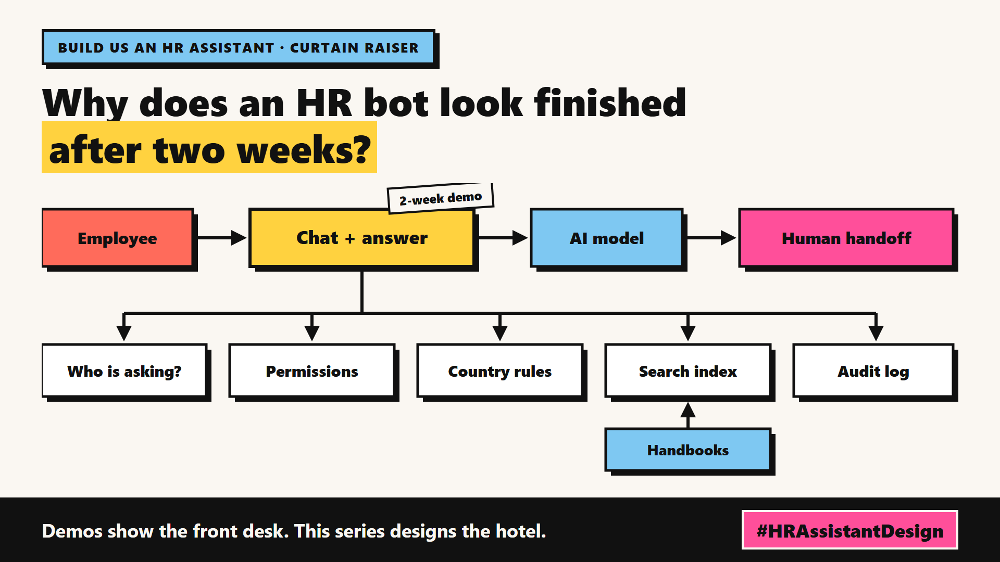

# 1. Why Does An HR Bot Look Finished After Two Weeks? | Framing The Brief



*Build Us an HR Assistant series: the curtain raiser*

"Build us an assistant that answers HR questions for 20,000 staff."

That was the whole brief. One slide, lots of nodding. [MY STORY: a kickoff where a brief this short landed on your desk]

At the whiteboard it looks easy: question in, handbook search, answer out. Someone says "two weeks?" and nobody laughs.

And the first version really does take two weeks. A typical team loads 40 handbook PDFs into a chat-with-your-documents tool, asks "How many days of annual leave do I get?", and gets a tidy answer with a page number. The sponsor smiles. Someone pencils in a launch date.

Then I started asking the questions demos skip:

1. "I work in Germany. Does the 20-day leave rule in the global handbook apply to me?"
2. "The handbook says 20 days. The March update says 22. Which one is right?"
3. "What is the salary range for my manager's job?" Should the bot even know?
4. "How many leave days do I have left?" That answer is in no PDF. It lives in the HR system, and it is private.
5. "Can I be dismissed for taking sick leave during probation?" That is close to legal advice.
6. "Who asked about redundancy pay last week?" Every question is itself sensitive data.

None of these break the demo. All of them break the launch.

## The hotel front desk

Think of a good hotel front desk. A guest asks, "What time is breakfast?" and gets a warm, quick answer. That part is the demo. It takes two weeks.

But the desk only works because of everything behind it:

- **The key cabinet.** Not every guest gets every key. Salary data needs the same care.
- **The guest register.** The desk knows who you are and which branch's rules apply to you.
- **The house rules for each branch.** A hotel in Berlin and one in Boston run under different laws.
- **The noticeboard.** When a rule changes, the old notice comes down the same day.
- **The duty manager.** Some questions belong with a human.
- **The logbook.** You can show what was said, and why.

Guests never see the back office. They only notice when it is missing.

For the budget, this means the two-week demo is the cheap part: fund the back office as the real project, or the timeline slips after launch instead of before it.

## This is a series: here's what's coming

Each write-up designs one part the way I would defend it in a design review: requirement, options, trade-offs, choice. Same HR assistant, same hotel.

A taste:

- How the bot gives an employee in Pune and one in Porto different, correct answers.
- Who is allowed to see which salary range, and how search respects that.
- What the bot should say when it is not sure.

## Take this to your next design review

1. Ask for the six hardest questions before you watch the demo.
2. Write down where each answer lives: a shared document, a private record, or a human.
3. Treat "who is asking" as a design input from day one, not a feature for version two.

A demo proves the front desk can talk; this series is about building the hotel behind it.

Next write-up (2): *What Is The HR Assistant Actually Allowed To Answer?*

Follow me for the next one.

What HR question would a bot like this get wrong first? Tell me in the comments.

*Previous series:* First series in this programme.

---

*Post text (copy and paste):*

```
"Build us an assistant that answers HR questions for 20,000 staff."
One slide. Lots of nodding.
The demo took two weeks.

The demo is the front desk. The hotel is still missing.

New series, Build Us an HR Assistant: designing an HR bot that survives launch.
What would trip up your HR bot first?
#AISystemDesign #EnterpriseAI #RAG #HRAssistantDesign
```

*Series index (post as the first comment, then pin it):*

```
📌 Build Us an HR Assistant
1. Why Does An HR Bot Look Finished After Two Weeks? <LinkedIn URL> (you're here)
2. What Is The HR Assistant Actually Allowed To Answer? (next)
```
