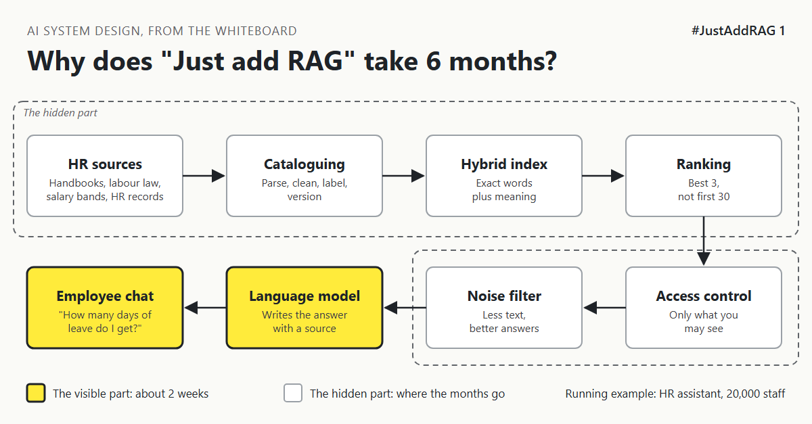

# 1. Why Does "Just Add RAG" Sound Like 2 Weeks But Take 6 Months? | "Just add RAG over our HR docs. Two weeks?"



*#JustAddRAG series: the curtain raiser*

"Can we just add RAG over our HR docs? Two weeks, maybe three?"

Everyone nodded. Someone drew three boxes on the whiteboard: documents, a vector database, a chat window. Two arrows. It looked finished.

So a typical team builds the prototype for an HR assistant that will serve 20,000 staff. Fifty handbook PDFs go in. A question goes in: "How many days of annual leave do I get?" A neat, polite answer comes out, with a link to the page it came from. People clap. The demo works.

Then I started asking the questions demos skip:

- The global handbook says one number for annual leave. German law says something else for German staff. Which one does the assistant believe?
- The salary band spreadsheet sits in the same folder. What stops an intern asking for the CFO's band?
- Someone types the policy code "HR-PL-204". Does a search built on meaning know what a code means?
- The leave policy changed in March. Which of the three copies did we load?
- Half the benefits guide is tables. What happens to a table when it becomes one long line of text?
- 20,000 people ask questions on the first Monday of open enrolment. How fast is it then?

## A bookshelf is not a city library

The demo is a bookshelf in your living room. You know every book. You find things from memory. Nobody else touches it.

An enterprise assistant is a city library. New books arrive every week, in many languages. Some rooms need a staff badge. Old editions have to leave the shelves. And a good librarian does not hand you the 40 books that mention "leave". They hand you the 2 that answer your question.

The visible part, the chat window and a nice answer, really does take about 2 weeks. The hidden part decides whether the system survives:

- **Cataloguing:** turning messy PDFs, tables and scans into clean, labelled text.
- **Indexing:** finding things by meaning and by exact words, like policy codes.
- **Ranking:** putting the best 3 passages on top, not the first 30.
- **Access control:** the assistant only reads what the person asking is allowed to read.
- **Noise filtering:** sending the model less text, not more.

[MY STORY: a real demo-to-production timeline you have lived through, and which hidden part took longest]

Most of the budget and most of the calendar sit in that hidden list, so fund the library and not just the bookshelf.

## This is a series: here's what's coming

A taste:

- Why the assistant finds "parental leave" but misses "HR-PL-204".
- How to stop a salary band reaching the wrong screen.
- Why giving the model more text makes the answer worse.

One running example: this HR assistant, from whiteboard sketch to a design you could defend in a review.

## Take this to your next design review

1. Ask "who is allowed to see this?" before you ask "which vector database?".
2. Test with the ugly documents: tables, scans, old versions and country rules, not just the clean handbook.
3. Size the hidden part first. The chat window is the cheapest box on the whiteboard.

A RAG demo proves the model can read; production proves the system knows what to read, for whom, and when.

Next write-up (2): *What Actually Happens To A PDF Before The Assistant Can Read It?*

Follow me for the next one.

What is the ugliest document your team has had to feed into an AI system? Tell me in the comments.

*Previous series:* First series in this programme.

---

*Post text (copy and paste):*

```
"Can we just add RAG over our HR docs? Two weeks?"
Three boxes on a whiteboard. A demo by Friday.
Then: what stops an intern seeing the CFO's salary band?

Why does "Just add RAG" take 6 months?

#JustAddRAG: an HR assistant for 20,000 staff that survives production.
What did your first RAG demo miss?
#AI #SystemDesign #RAG #EnterpriseAI #JustAddRAG
```

*Series index (post as the first comment, then pin it):*

```
📌 #JustAddRAG
1. Why Does "Just Add RAG" Sound Like 2 Weeks But Take 6 Months? [Pending Publish] (you're here)
2. What Actually Happens To A PDF Before The Assistant Can Read It? (next)
```
