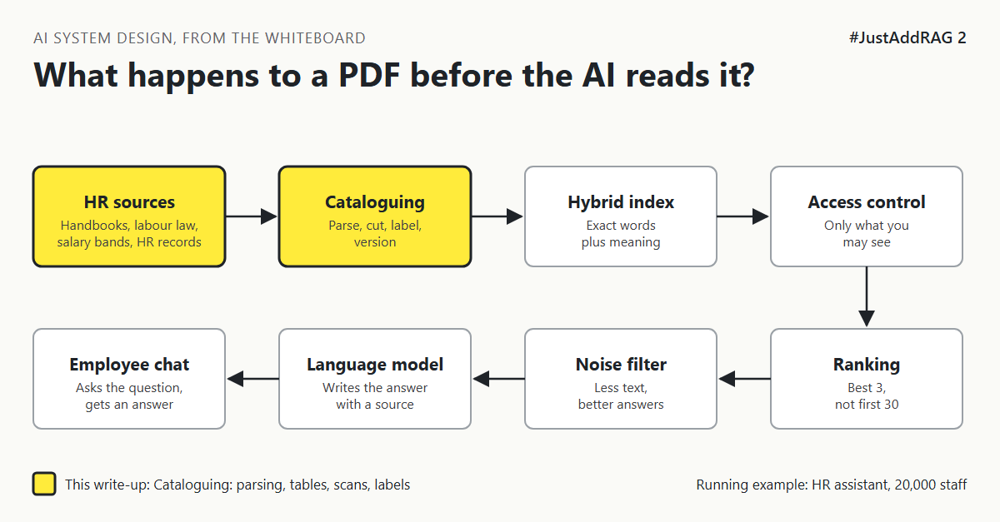

# 2. What Actually Happens To A PDF Before The Assistant Can Read It? | "We'll just upload the PDFs."



*#JustAddRAG series: write-up 2 of 10*

"We'll just upload the PDFs. The AI reads them."

That is a typical plan for an HR assistant serving 20,000 staff. Then someone opened the benefits guide the way a computer sees it.

The neat table of health plans had become one long line: "Gold Silver Bronze 1,500 3,000 5,000 80% 70% 60%". Every page started with "Company Confidential, Page 4 of 62". The scanned German works agreement was not text at all. It was a photograph of text.

The model never reads your PDF. It reads whatever the pipeline hands it.

## Cataloguing a donated box of books

Imagine a city library gets a box of 5,000 donated books. Nobody puts them straight on the shelves. A librarian opens each one, checks the edition, notes the language, stamps the subject, and marks the rare ones "reference only". That is cataloguing. Skip it and the library becomes a warehouse.

For the HR assistant, cataloguing has three jobs:

1. **Get the words out correctly**, including tables and scans.
2. **Remove the noise**: repeated headers, footers, page numbers, legal boilerplate.
3. **Label every piece**: country, document type, version, effective date, owner, and who may read it.

The third job is the one teams postpone. It is also the one that is painful to add later, because adding a label means processing every document again.

## The options

**Option A: Plain text extraction.** A standard library pulls the text layer out of each PDF. Fast and free.

**Option B: Layout-aware parsing.** A parser that understands pages: headings, columns, tables, lists. Tables come out as tables. Examples include open-source tools such as Docling or Unstructured, and cloud services such as Azure AI Document Intelligence or Amazon Textract.

**Option C: Send every page to a vision model.** Render each page as an image and ask a multimodal model to write it out as clean, structured text.

| Option | Good at | Bad at | Pick it when |
|---|---|---|---|
| A. Plain text extraction | Fast, free, simple to run | Flattens tables, fails on scans, keeps headers and footers | Documents are mostly prose and born digital |
| B. Layout-aware parsing | Keeps tables and headings, handles most scans with OCR | Costs money per page, needs tuning for odd layouts | Mixed documents with tables, like benefits guides |
| C. Vision model on every page | Handles the strangest layouts and handwriting | Slowest and most expensive, can quietly invent text | A small set of difficult documents |

## What I would pick, and why

Option B as the default, with Option C kept for the handful of pages B cannot read. Plain extraction (A) is fine for a demo, but HR answers often live inside tables: plan limits, eligibility, notice periods by length of service.

Then the labels. Every document gets a small record before it is split up: country, language, document type, version, effective date, owner, and access groups. Every piece later inherits it.

In money terms, parsing is the cheap part; the expensive part is the calendar time lost if the labels are missing and the whole library has to be processed and checked again.

## What would change my mind

- If almost everything is plain prose, Option A plus header and footer removal is enough.
- If HR already holds the policies as structured pages in an intranet or HR platform, read that source instead of the PDF export. The best PDF parser is not needing one.

## How it fails

- **Silent table damage.** The answer quotes the Silver plan's limit for the Gold plan. Nothing crashes.
- **Missing scans.** Image-only pages come through empty, so the assistant "doesn't know" about a policy that exists.
- **Duplicate copies.** The same handbook sits in three folders and gets loaded three times.
- **Hidden instructions inside a PDF** that try to steer the model. That is a security problem, covered in #DefendingAI.

## Rough numbers

| Item | Estimate |
|---|---|
| Documents | 3,000 to 5,000 [CHECK] |
| Pages | About 100,000 [CHECK] |
| Cloud layout parsing | Roughly 10 to 15 US dollars per 1,000 pages with tables [CHECK: current price list] |
| One full parse of the library | Roughly 1,000 to 1,500 US dollars [CHECK] |
| Share of pages that are scans | Unknown until measured [CHECK: sample 200 documents] |

## Words to know

- **Ingestion:** the pipeline that turns source documents into searchable pieces.
- **OCR (optical character recognition):** turning a picture of text into text.
- **Layout-aware parsing:** extraction that understands headings, columns and tables.
- **Metadata:** labels attached to a document or piece, such as country or version.

## Take this to your next design review

1. Open your three worst documents the way the computer sees them before choosing a parser.
2. Decide the labels (country, version, effective date, access) before the first document is loaded.
3. Keep the original file and a fingerprint of it, so you only re-process what changed.

Garbage in, confident garbage out: the catalogue decides the quality of every answer that follows.

Next write-up (3): *How Small Can You Cut A Policy Before It Stops Making Sense?*

Follow me for the next one.

What is the strangest thing you have found inside a "simple" PDF? Tell me in the comments.

*New to the series?* Start with write-up 1: *Why Does "Just Add RAG" Sound Like 2 Weeks But Take 6 Months?* [Pending Publish]

---

*Post text (copy and paste):*

```
"We'll just upload the PDFs. The AI reads them."
Then we looked at the benefits table the way a computer sees it.
One long line of numbers. No columns. No plan names.

The model never reads your PDF. It reads what your pipeline hands it.

#JustAddRAG, write-up 2: cataloguing the library.
What broke your first ingestion?
#AI #SystemDesign #RAG #DataEngineering #JustAddRAG
```

*Series index (post as the first comment, then pin it):*

```
📌 #JustAddRAG
1. Why Does "Just Add RAG" Sound Like 2 Weeks But Take 6 Months? [Pending Publish]
2. What Actually Happens To A PDF Before The Assistant Can Read It? [Pending Publish] (you're here)
3. How Small Can You Cut A Policy Before It Stops Making Sense? (next)
```
