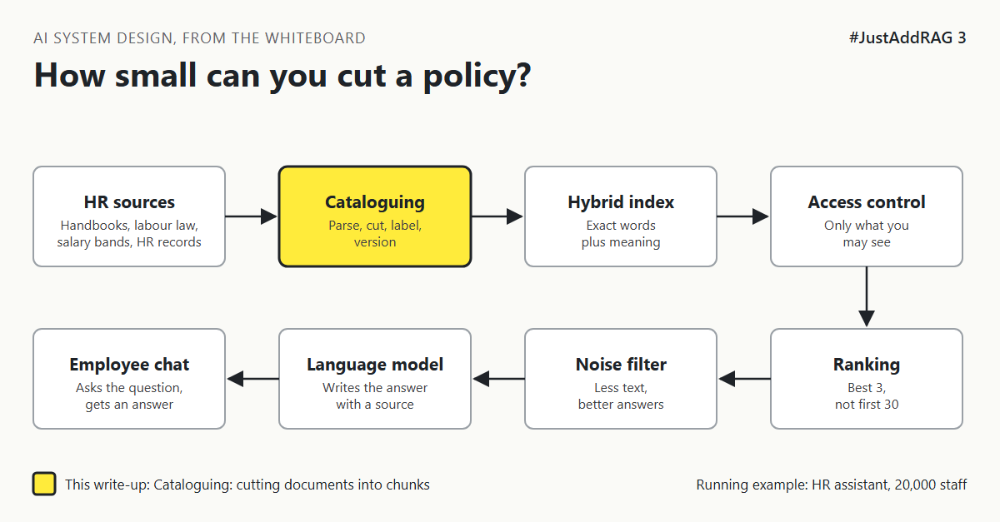

# 3. How Small Can You Cut A Policy Before It Stops Making Sense? | "Just split the documents into pages."



*#JustAddRAG series: write-up 3 of 10*

"Just split the documents into pages. Simple."

An employee asks the HR assistant: "Can I carry over unused leave?"

The search finds page 14 of the handbook. It says: "Yes, up to 5 days, subject to the conditions below."

The conditions are on page 15. Page 15 was not retrieved. The assistant answers "Yes, up to 5 days" with total confidence, and leaves out the part that says it expires on 31 March.

The answer was cut in half before anyone asked the question.

## Tearing pages versus photocopying chapters

Imagine you could only hand library visitors loose pieces of paper, not whole books.

Tear out single sentences and nobody knows what they refer to. "This does not apply to part-time staff." What doesn't?

Hand over whole chapters and visitors drown. They wanted one rule and got 40 pages.

Good chunking is photocopying the right section: big enough to make sense alone, small enough to be about one thing. In technical terms, a **chunk** is one piece of a document that is searched and sent to the model on its own.

## The options

**Option A: Fixed-size chunks.** Cut every few hundred words, with a little overlap so sentences on the boundary are not lost. Easy and predictable.

**Option B: Structure-aware chunks.** Cut along the document's own headings and sections. A table stays with its heading. A rule stays with its conditions.

**Option C: Small pieces for search, big pieces for reading.** Search over small, precise chunks. When one matches, hand the model the whole section it belongs to. This is often called parent and child chunking.

| Option | Good at | Bad at | Pick it when |
|---|---|---|---|
| A. Fixed size | Simple, works on any text | Cuts rules from their conditions, splits tables | Documents have no useful structure |
| B. Structure-aware | Keeps meaning together | Sections vary wildly in size, needs good parsing first | Well-structured handbooks and policies |
| C. Small for search, big for reading | Precise matching and complete context | More storage and more moving parts | Long sections where details hide inside |

## What I would pick, and why

Option B as the base, with Option C for long sections. HR handbooks are written in sections for a reason: each one is usually a single rule with its exceptions.

Two small habits make a large difference:

1. **Carry the heading path into every chunk.** A chunk that starts with "Handbook > Leave > Carry-over > Germany" is easy to match and hard to misread.
2. **Never split a table.** If it is too big, split by rows and repeat the header row in each piece.

In risk terms, bad chunking does not cause errors you can see, it causes half-answers that sound complete, which is the most expensive kind of wrong in HR.

## What would change my mind

- If documents are short FAQ entries, each entry is already a perfect chunk. No splitting needed.
- If parsing quality is poor (lesson 1.2 skipped), structure-aware chunking has no structure to follow. Fix parsing first.

## How it fails

- **Orphaned conditions.** The rule is retrieved, its exception is not.
- **Pronouns without owners.** "It applies after probation." What does?
- **Tables split down the middle.** Plan names in one chunk, numbers in another.
- **Giant chunks.** One 3,000-word section swamps everything else the model sees (more on that in write-up 8).

## Rough numbers

| Item | Estimate |
|---|---|
| Typical chunk size | 200 to 800 tokens [CHECK: test on your documents] |
| Overlap for fixed-size chunks | 10 to 20 percent [CHECK] |
| Chunks for 100,000 pages | 200,000 to 400,000 [CHECK] |
| Extra storage for parent and child | Roughly 2 times the chunk text [CHECK] |

## Words to know

- **Chunk:** one searchable piece of a document.
- **Overlap:** text repeated at the end of one chunk and the start of the next.
- **Heading path:** the chain of headings above a chunk, added to it as context.
- **Parent and child chunking:** search small pieces, return their larger section.

## Take this to your next design review

1. Read 20 random chunks out loud. If one does not make sense alone, the strategy is wrong.
2. Keep every rule in the same chunk as its conditions and every table with its header.
3. Add the heading path to each chunk before it is embedded.

A chunk should answer one question completely, not half of two.

Next write-up (4): *Why Does The Assistant Find "Parental Leave" But Miss "HR-PL-204"?*

Follow me for the next one.

What is your go-to chunk size, and how did you choose it? Tell me in the comments.

*New to the series?* Start with write-up 1: *Why Does "Just Add RAG" Sound Like 2 Weeks But Take 6 Months?* [Pending Publish]

---

*Post text (copy and paste):*

```
"Just split the documents into pages."
Page 14: "Yes, carry over up to 5 days, see conditions below."
The conditions were on page 15. It was never retrieved.

The answer was cut in half before anyone asked.

#JustAddRAG, write-up 3: chunking without losing the point.
How do you chunk?
#AI #SystemDesign #RAG #LLM #JustAddRAG
```

*Series index (post as the first comment, then pin it):*

```
📌 #JustAddRAG
1. Why Does "Just Add RAG" Sound Like 2 Weeks But Take 6 Months? [Pending Publish]
2. What Actually Happens To A PDF Before The Assistant Can Read It? [Pending Publish]
3. How Small Can You Cut A Policy Before It Stops Making Sense? [Pending Publish] (you're here)
4. Why Does The Assistant Find "Parental Leave" But Miss "HR-PL-204"? (next)
```
