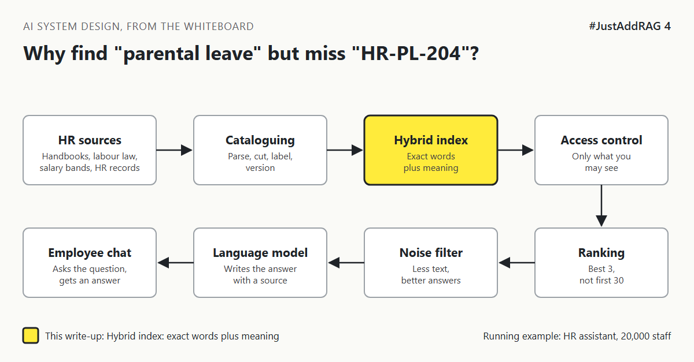

# 4. Why Does The Assistant Find "Parental Leave" But Miss "HR-PL-204"? | "It's AI search. It understands what we mean."



*#JustAddRAG series: write-up 4 of 10*

"It's AI search. It understands what we mean."

It does. An employee types "time off when my baby arrives" and the HR assistant finds the parental leave policy, even though the words barely overlap. Lovely.

Then a manager types "HR-PL-204 Germany". The assistant returns a cheerful paragraph about the company's values. The policy code meant nothing to it.

Both searches were "AI search". Only one of them was the right kind.

## The librarian and the call number

A city library offers two ways to find a book.

You can describe what you want to a librarian: "something about raising a toddler". A good librarian understands and walks you to the right shelf, even if you used none of the words in the title.

Or you can hand over a call number: "649.122". No understanding needed. The number points to exactly one place.

Search by meaning is the librarian. It works by turning text into an **embedding**, a list of numbers where similar meanings sit close together. It is wonderful with natural questions and poor with codes, IDs, names and rare words, because "HR-PL-204" has no meaning to understand.

Search by exact words is the call number. The classic method is called **BM25**. It scores passages by matching words, giving extra weight to rare ones. It is wonderful with codes and names and poor with synonyms.

HR questions need both.

## The options

**Option A: Meaning search only (vectors).** What most demos ship.

**Option B: Keyword search only (BM25).** What most intranets already had.

**Option C: Hybrid search.** Run both, then merge the two ranked lists into one. A common and simple merge method is **Reciprocal Rank Fusion**: a passage near the top of either list rises to the top of the merged list.

| Option | Good at | Bad at | Pick it when |
|---|---|---|---|
| A. Meaning only | Natural questions, synonyms, other phrasings | Codes, names, acronyms, rare terms | Questions are always conversational |
| B. Keywords only | Codes, names, exact phrases | Synonyms and everyday wording | Users search like librarians |
| C. Hybrid | Both kinds of question in one system | Two indexes to keep in step, a merge step to tune | Real employees, real questions |

## What I would pick, and why

Hybrid. Employees ask "can I work from Spain for a month?" and managers paste "HR-PL-204" in the same week. Many search products can now hold both kinds of index side by side, for example Elasticsearch, OpenSearch, Azure AI Search, Weaviate, or PostgreSQL with pgvector and full-text search.

Two details matter in a global company:

1. **Language.** Keyword search needs the right language rules per document, so German compound words are split sensibly. Meaning search needs an embedding model that handles every language you serve.
2. **Labels as filters.** Country and document type from write-up 2 narrow the search before ranking starts. "Germany" in the question should become a filter, not just another word.

In timeline terms, hybrid search costs a few extra days at the start, while bolting it on after launch means re-indexing and re-testing every answer.

## What would change my mind

- If every question is conversational and there are no codes or product names, meaning search alone may do.
- If the assistant is really a policy lookup tool for HR specialists, keyword search with good filters might be enough.

## How it fails

- **Codes and acronyms vanish** in meaning-only search.
- **Synonyms vanish** in keyword-only search: "maternity" never finds "parental".
- **One list dominates** the merge because its scores were not on the same scale. Rank-based merging avoids this.
- **Wrong language rules** make German or Japanese keyword search quietly poor.

## Rough numbers

| Item | Estimate |
|---|---|
| Hybrid query time on 300,000 chunks | Tens of milliseconds [CHECK: measure on your engine] |
| Candidates taken from each list | 25 to 50 [CHECK] |
| Share of queries containing codes or names | Unknown until measured [CHECK: sample real queries] |

## Words to know

- **Embedding:** numbers that represent meaning.
- **Vector search:** finding embeddings close to the question's embedding.
- **BM25:** a classic keyword ranking method that rewards rare matching words.
- **Hybrid search:** running both and merging results.
- **Reciprocal Rank Fusion:** a merge method based on position in each list, not raw score.

## Take this to your next design review

1. Collect 50 real employee questions and count how many contain a code, name or acronym.
2. Run both searches on day one, not after the first complaint.
3. Turn countries and document types into filters, not search words.

Meaning finds what you mean; keywords find what you said; employees need both.

Next write-up (5): *Why Is The First Search Result So Often Not The Best One?*

Follow me for the next one.

Have you seen meaning search miss something a keyword search would have found instantly? Tell me in the comments.

*New to the series?* Start with write-up 1: *Why Does "Just Add RAG" Sound Like 2 Weeks But Take 6 Months?* [Pending Publish]

---

*Post text (copy and paste):*

```
"It's AI search. It understands what we mean."
"Time off when my baby arrives" found the right policy.
"HR-PL-204 Germany" found a paragraph about company values.

Meaning search cannot read a call number.

#JustAddRAG, write-up 4: hybrid search for real questions.
Have you hit this?
#AI #SystemDesign #RAG #Search #JustAddRAG
```

*Series index (post as the first comment, then pin it):*

```
📌 #JustAddRAG
1. Why Does "Just Add RAG" Sound Like 2 Weeks But Take 6 Months? [Pending Publish]
2. What Actually Happens To A PDF Before The Assistant Can Read It? [Pending Publish]
3. How Small Can You Cut A Policy Before It Stops Making Sense? [Pending Publish]
4. Why Does The Assistant Find "Parental Leave" But Miss "HR-PL-204"? [Pending Publish] (you're here)
5. Why Is The First Search Result So Often Not The Best One? (next)
```
