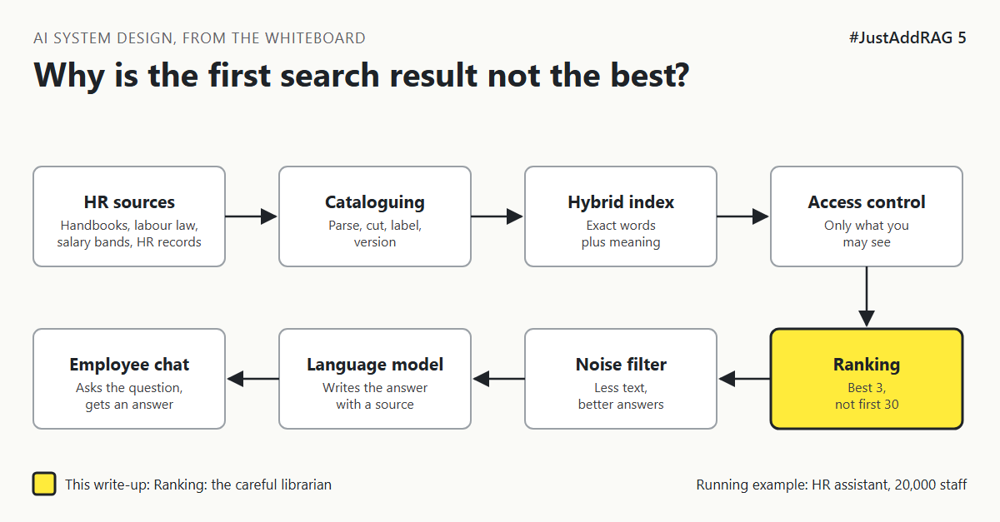

# 5. Why Is The First Search Result So Often Not The Best One? | "Just send the top 20 results to the model."



*#JustAddRAG series: write-up 5 of 10*

"Just send the top 20 results to the model. It will work out which ones matter."

An employee asks the HR assistant: "Does my health plan cover physiotherapy after surgery?"

Search returns 20 passages. Number 1 is a general paragraph about the health plan. Number 2 is about dental. The passage that actually answers the question, the physiotherapy limits table, is number 14.

The model reads all 20, gives the general paragraph the most weight, and replies: "Yes, the plan covers a range of treatments." True, vague and no help.

## The librarian who checks before handing over

A busy librarian can do a quick search of the catalogue and hand you the first 20 books with matching titles. Fast, but rough.

A better librarian takes those 20 books, opens each one, reads the relevant page next to your question, and hands you the 3 that really answer it. Slower per book, far better result.

Search is the quick catalogue lookup. It has to scan hundreds of thousands of chunks, so it uses shortcuts: it compares the question and each chunk separately, as summaries. A **reranker** is the careful librarian. It reads the question and one candidate passage *together* and scores how well that passage answers that question. Too slow for the whole library, perfect for a shortlist.

## The options

**Option A: No reranking.** Send the top results from hybrid search (write-up 4) straight to the model.

**Option B: A cross-encoder reranker.** A small model built for this one job. Take the top 50 from search, rescore them, keep the best 5. Examples include open-source rerankers such as the BGE reranker family, or hosted services such as Cohere Rerank.

**Option C: Ask a large language model to rerank.** Give the model the question and the candidates and ask it to pick the best.

| Option | Good at | Bad at | Pick it when |
|---|---|---|---|
| A. No reranking | Fastest, simplest | Best passage often buried, more text sent to the model | Small, clean library, very simple questions |
| B. Cross-encoder | Large accuracy gain for a small delay | One more model to host or pay for, input length limits | Most enterprise RAG systems |
| C. LLM reranking | Can follow complex instructions about relevance | Slow and costly per question, results can vary run to run | Low volume, very high-value questions |

## What I would pick, and why

Option B. Search gathers about 50 candidates, the reranker keeps the best 5. The model then reads 5 focused passages instead of 20 noisy ones, which helps accuracy, speed and cost at once.

Two cautions:

1. **Rerankers read a limited amount of text per passage.** Very long chunks get cut off. Chunk sizes from write-up 3 matter here.
2. **Rerankers do not know the rules.** A German passage might score highest for a French employee. Country and access filters must already have been applied before reranking.

In budget terms, a reranker is one of the cheapest accuracy improvements in the whole pipeline because it lets you send the expensive model a fraction of the text.

## What would change my mind

- If search already puts the right passage first almost every time on real questions, the reranker is paying for nothing.
- If answer time is extremely tight and the reranker cannot run fast enough on available hardware, a smaller shortlist or a lighter reranker may be the compromise.

## How it fails

- **Truncated passages** lose the deciding sentence.
- **Shortlist too short:** if the right passage was not in the top 50, no reranker can rescue it.
- **Filters applied after reranking:** a perfectly relevant passage from the wrong country wins.
- **A cut-off score set once and forgotten** drops good passages when documents change.

## Rough numbers

| Item | Estimate |
|---|---|
| Candidates sent to the reranker | 30 to 100, often 50 [CHECK] |
| Reranker time for 50 candidates | About 100 to 300 milliseconds on suitable hardware [CHECK] |
| Passages kept after reranking | 3 to 8 [CHECK] |
| Model input saved compared with sending 20 | Roughly 60 to 75 percent [CHECK] |

## Words to know

- **Reranker:** a model that rescores a shortlist of search results against the question.
- **Cross-encoder:** a reranker that reads the question and passage together.
- **Bi-encoder:** the faster approach used in vector search, which encodes question and passage separately.
- **Shortlist (top-k):** the number of candidates passed from one stage to the next.

## Take this to your next design review

1. Check where the correct passage lands in search results for 30 real questions.
2. Filter by country and access before reranking, never after.
3. Send the model fewer, better passages.

Search finds candidates; reranking chooses the answer.

Next write-up (6): *How Do You Stop A Salary Band Reaching The Wrong Screen?*

Follow me for the next one.

Did adding a reranker change your results, or was it noise? Tell me in the comments.

*New to the series?* Start with write-up 1: *Why Does "Just Add RAG" Sound Like 2 Weeks But Take 6 Months?* [Pending Publish]

---

*Post text (copy and paste):*

```
"Just send the top 20 results to the model."
The physiotherapy table was result 14.
The model trusted result 1 and gave a vague answer.

Search finds candidates. Something has to choose.

#JustAddRAG, write-up 5: reranking, the careful librarian.
Do you rerank?
#AI #SystemDesign #RAG #Search #JustAddRAG
```

*Series index (post as the first comment, then pin it):*

```
📌 #JustAddRAG
1. Why Does "Just Add RAG" Sound Like 2 Weeks But Take 6 Months? [Pending Publish]
2. What Actually Happens To A PDF Before The Assistant Can Read It? [Pending Publish]
3. How Small Can You Cut A Policy Before It Stops Making Sense? [Pending Publish]
4. Why Does The Assistant Find "Parental Leave" But Miss "HR-PL-204"? [Pending Publish]
5. Why Is The First Search Result So Often Not The Best One? [Pending Publish] (you're here)
6. How Do You Stop A Salary Band Reaching The Wrong Screen? (next)
```
