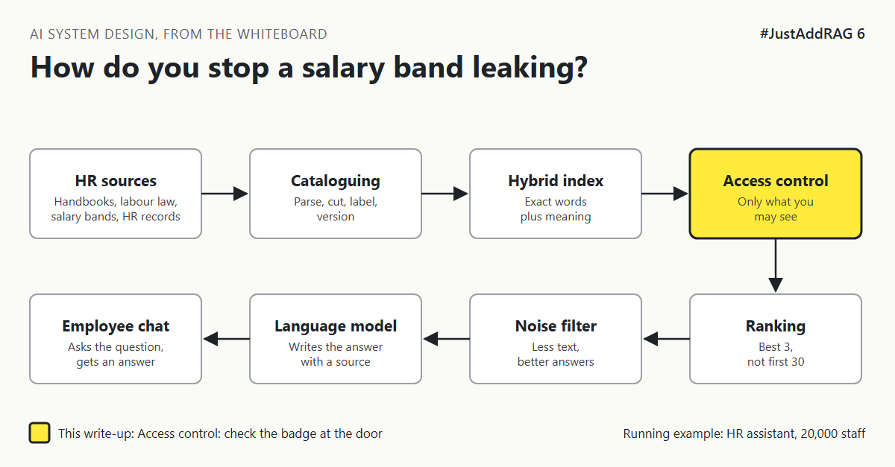

# 6. How Do You Stop A Salary Band Reaching The Wrong Screen? | "Everyone can use it, but nobody sees what they shouldn't."



*#JustAddRAG series: write-up 6 of 10*

"Everyone can use it, but nobody sees what they shouldn't. Easy, right?"

The HR assistant serves 20,000 people. Its library holds the global handbook, which everyone may read. It also holds country salary bands, which only HR and senior managers may read. And a draft restructuring policy that only five people know exists.

A curious graduate asks: "What is the salary range for a Director in London?"

If that spreadsheet is in the index, and nothing stops search from finding it, the model will answer helpfully. Models are very good at being helpful. That is the problem.

## The rare books room

A city library is open to everyone. But some rooms need a badge: rare manuscripts, archives, the local council's records.

The important detail is *where* the badge is checked. A sensible library checks it at the door of the room. A silly library lets anyone walk in, pick up a manuscript, and only checks the badge at the exit, hoping nobody read anything on the way.

In a RAG system, the "room" is the search index. The badge is the user's identity and group memberships. The question is whether you check the badge before search, during search, or after it.

## The options

**Option A: Separate indexes per audience.** One index for all staff, another for HR, another for executives. Each user searches only the indexes they may use.

**Option B: Search everything, then remove forbidden results.** Run the search, then drop any result the user may not see before passing results to the model.

**Option C: Filter during search (security trimming).** Every chunk carries a list of groups allowed to read it (an **access control list**, or ACL). Each search includes the user's groups as a filter, so forbidden chunks are never candidates at all.

| Option | Good at | Bad at | Pick it when |
|---|---|---|---|
| A. Separate indexes | Very easy to understand and audit | Copies multiply when audiences overlap, rules get coarse | A few clear audiences that rarely overlap |
| B. Filter after search | Easy to add to an existing demo | Results can empty out, ranking wasted, one missed check leaks data | Never as the only control |
| C. Filter during search | Precise, scales to many groups, nothing forbidden is ever retrieved | Needs permissions synced from source systems | Many overlapping audiences, like a global HR team |

## What I would pick, and why

Option C, plus one firm rule: **the most sensitive data does not go into the index at all.**

Salary bands are a good example. An employee asking about their own pay range should get it from the HR system, with that system checking their entitlement (write-up 9 covers this). Putting every band into a shared search index and relying on a filter is one bug away from an incident.

For everything else, chunks inherit their access groups from the document record in write-up 2, and every search includes the asking user's groups. Default is deny: a chunk with no groups is visible to nobody.

On risk, this is the decision that most affects whether the assistant can be approved by security and works councils at all, so it belongs in week one, not in the hardening phase.

## What would change my mind

- If there are only two audiences (all staff, HR) and they never overlap, Option A is simpler and easier to explain to an auditor.
- If the source system already offers search with its own permission trimming, querying it may beat copying permissions into a new index.

## How it fails

- **Stale permissions.** Someone moves out of HR on Monday and can still see HR documents on Friday because groups sync weekly.
- **Missing labels.** A document loaded without groups is visible to everyone instead of no one.
- **Leaks through the side door.** Search is trimmed, but suggested questions, logs or cached answers are not.
- **Identity passed loosely.** The assistant searches as a powerful service account instead of as the user. Delegating identity safely is covered in #DefendingAI.

## Rough numbers

| Item | Estimate |
|---|---|
| Groups per employee | Tens to a few hundred [CHECK: your directory] |
| Permission sync delay target | Minutes, not days [CHECK: agree with security] |
| Extra query time for group filters | Small when the engine filters natively [CHECK: measure] |

## Words to know

- **ACL (access control list):** the list of who may read something.
- **Security trimming:** removing items a user may not see as part of the search itself.
- **Default deny:** if no rule allows access, access is refused.
- **Permission sync:** copying group memberships from the source system to the index.

## Take this to your next design review

1. Check the badge at the door: filter during search, not after.
2. Keep the most sensitive data out of the index and behind its own system.
3. Ask how fast a role change reaches the index, and test it.

An assistant should know only what the person asking is allowed to know.

Next write-up (7): *Which Copy Of The Leave Policy Is The True One?*

Follow me for the next one.

Where did your team decide to enforce document permissions in RAG? Tell me in the comments.

*New to the series?* Start with write-up 1: *Why Does "Just Add RAG" Sound Like 2 Weeks But Take 6 Months?* [Pending Publish]

---

*Post text (copy and paste):*

```
"Everyone can use it, but nobody sees what they shouldn't."
A graduate asks the HR assistant for a Director's salary range.
The spreadsheet is in the index. The model wants to help.

Check the badge at the door, not at the exit.

#JustAddRAG, write-up 6: access control in retrieval.
Where do you enforce it?
#AI #SystemDesign #RAG #Security #JustAddRAG
```

*Series index (post as the first comment, then pin it):*

```
📌 #JustAddRAG
1. Why Does "Just Add RAG" Sound Like 2 Weeks But Take 6 Months? [Pending Publish]
2. What Actually Happens To A PDF Before The Assistant Can Read It? [Pending Publish]
3. How Small Can You Cut A Policy Before It Stops Making Sense? [Pending Publish]
4. Why Does The Assistant Find "Parental Leave" But Miss "HR-PL-204"? [Pending Publish]
5. Why Is The First Search Result So Often Not The Best One? [Pending Publish]
6. How Do You Stop A Salary Band Reaching The Wrong Screen? [Pending Publish] (you're here)
7. Which Copy Of The Leave Policy Is The True One? (next)
```
