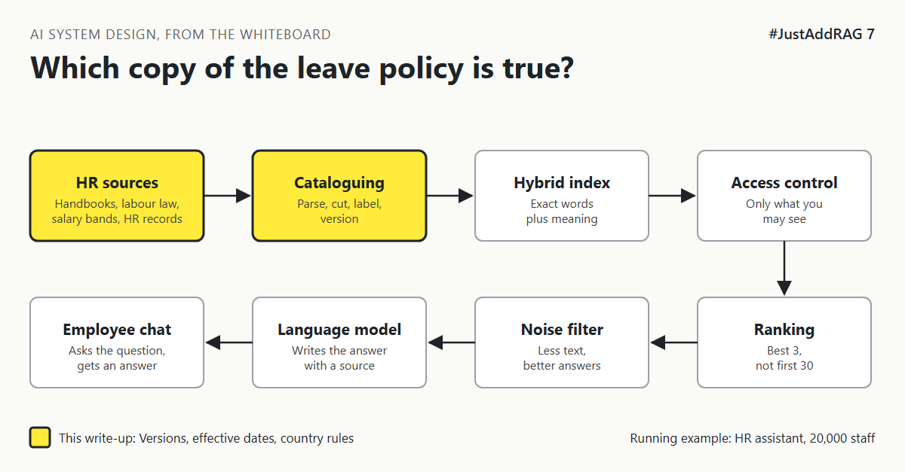

# 7. Which Copy Of The Leave Policy Is The True One? | "The policy changed last week. Does the bot know?"



*#JustAddRAG series: write-up 7 of 10*

"The leave policy changed last week. Does the bot know?"

The HR assistant's library holds three copies of the leave policy: last year's, this year's, and a draft for next January that someone saved in the wrong folder. It also holds a global rule and a German rule that says something different for German staff.

An employee in Munich asks: "How much annual leave do I get?"

The assistant finds four passages, all relevant, all well written, and they disagree. It picks one. Nobody can tell which one, or why.

## Old editions and local editions

A good library handles this every day.

When a new edition of a book arrives, the old one leaves the open shelves. It may go to the archive, but nobody borrowing a book today gets it by accident. A book announced for next year is not shelved yet.

A national library also keeps local editions. The national guide to tenancy law sits next to the regional supplement, and the librarian knows: for a tenant in this region, the supplement wins where they differ.

The assistant needs both habits: **one current version per document**, and **a clear rule for which document wins** when a global and a local rule disagree.

## The options

**Option A: Replace in place.** When a document changes, delete its old chunks and load the new ones. Only the latest version exists.

**Option B: Versions with effective dates.** Keep each version with "valid from" and "valid to" dates. Search only returns chunks valid on the date that matters, usually today.

**Option C: Versions plus a country override layer.** As Option B, and every chunk also says whether it is a global rule or a local one, and what it overrides. Retrieval brings back both and labels them, so the answer can say: "The global rule is X. In Germany, Y applies instead."

| Option | Good at | Bad at | Pick it when |
|---|---|---|---|
| A. Replace in place | Simple, no stale versions | Cannot answer about past or future dates, deletions must be perfect | One country, policies rarely future-dated |
| B. Effective dates | Correct for today and for "what changes in January?" | More metadata, needs reliable dates | Policies are announced ahead of time |
| C. Dates plus override layer | Correct for the person's country, explains why | Needs a clear owner for precedence rules | Global company with local law |

## What I would pick, and why

Option C. A 20,000-person company in about 30 countries [CHECK] will have local rules that legally override global policy. The assistant must not leave that to chance.

Three practical rules make it work:

1. **Dates come from HR, not from the file.** "Last modified" says when someone saved it, not when it takes effect.
2. **Drafts never enter the index.** Only published documents, from a published location.
3. **Precedence is data, not a prompt.** Each local chunk is labelled as overriding a global topic, so retrieval can bring both and present them in order.

For the timeline, this needs HR owners in each country to confirm dates and precedence, so plan their time early or the launch will wait for them.

## What would change my mind

- A single country with one handbook and no future-dated changes: Option A is enough.
- If the HR platform already publishes policies with effective dates and country scope, use its data instead of rebuilding it.

## How it fails

- **The zombie policy:** deleted from the folder, still in the index.
- **The early bird:** next year's draft answering this year's question.
- **The silent override:** the German rule exists, but the global rule ranks higher and wins.
- **The wrong "today":** time zones near the change date (an employee in Sydney is already in January).

## Rough numbers

| Item | Estimate |
|---|---|
| Policy changes per year across all countries | Hundreds [CHECK: ask HR] |
| Target delay from publish to assistant | Within a day [CHECK: agree with HR] |
| Share of topics with local overrides | Unknown until mapped [CHECK: start with leave, notice, benefits] |

## Words to know

- **Effective date:** the date a policy version starts or stops applying.
- **Override:** a local rule that replaces a global one for some employees.
- **Precedence:** the order that decides which rule wins.
- **Tombstone:** a record that a document was deleted, so its chunks are removed everywhere.

## Take this to your next design review

1. Ask HR for effective dates, not file dates.
2. Store which rule overrides which as data in the index.
3. Test the day before and the day after a policy change.

The right answer depends on who is asking, where they work, and what day it is.

Next write-up (8): *Why Does Giving The Model More Text Make The Answer Worse?*

Follow me for the next one.

How does your team handle policy versions in RAG today? Tell me in the comments.

*New to the series?* Start with write-up 1: *Why Does "Just Add RAG" Sound Like 2 Weeks But Take 6 Months?* [Pending Publish]

---

*Post text (copy and paste):*

```
"The policy changed last week. Does the bot know?"
Three copies of the leave policy in the index.
One global rule, one German rule. They disagree.

Which copy is the true one?

#JustAddRAG, write-up 7: versions, dates and country rules.
How do you handle versions?
#AI #SystemDesign #RAG #HRTech #JustAddRAG
```

*Series index (post as the first comment, then pin it):*

```
📌 #JustAddRAG
1. Why Does "Just Add RAG" Sound Like 2 Weeks But Take 6 Months? [Pending Publish]
2. What Actually Happens To A PDF Before The Assistant Can Read It? [Pending Publish]
3. How Small Can You Cut A Policy Before It Stops Making Sense? [Pending Publish]
4. Why Does The Assistant Find "Parental Leave" But Miss "HR-PL-204"? [Pending Publish]
5. Why Is The First Search Result So Often Not The Best One? [Pending Publish]
6. How Do You Stop A Salary Band Reaching The Wrong Screen? [Pending Publish]
7. Which Copy Of The Leave Policy Is The True One? [Pending Publish] (you're here)
8. Why Does Giving The Model More Text Make The Answer Worse? (next)
```
