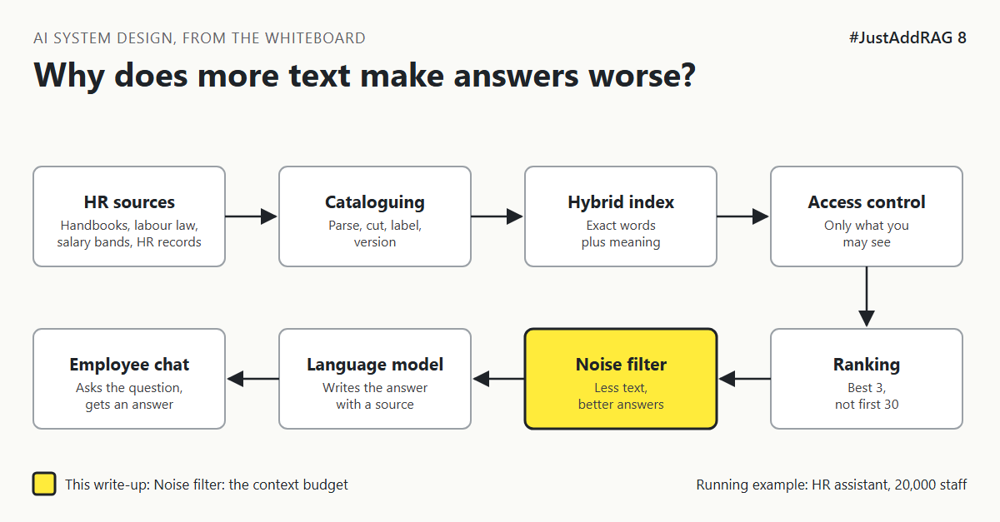

# 8. Why Does Giving The Model More Text Make The Answer Worse? | "Give it everything. The context window is huge."



*#JustAddRAG series: write-up 8 of 10*

"Give it everything. The context window is huge now."

It is. Modern models can read the equivalent of several books in one go. So the HR assistant's prompt grows: 30 passages, the full benefits guide "just in case", the employee's whole profile, and three pages of instructions.

An employee asks: "How many sick days can I take without a doctor's note?"

The answer is one sentence on page 9 of what the model received. The reply is long, polite, mentions annual leave, the wellbeing programme and the holiday calendar, and gets the number wrong.

It was also slower than it needed to be, and every extra page was paid for.

## The librarian with an armful of books

You ask a librarian one question. They return with 40 books, stacked to their chin, and say: "The answer is in here somewhere."

You will probably skim the first two and the last one, and miss the page that mattered.

Language models behave in a surprisingly similar way. A 2023 research paper called "Lost in the Middle" found that models used information at the start and end of a long input much better than information buried in the middle [CHECK: newer models vary, test yours]. More text is not free context. It is noise around the signal.

And every extra word has a price. Models charge by the **token**, roughly a piece of a word, for everything they read, on every question.

## The options

**Option A: Fixed number of passages.** Always send the top N passages, whatever their size.

**Option B: A token budget.** Decide how much text the model gets, for example 3,000 tokens of passages. Fill it with the best reranked passages, remove duplicates, and stop when the budget is full.

**Option C: Compress before sending.** Pull out only the relevant sentences from each passage, or summarise them, then send the result.

| Option | Good at | Bad at | Pick it when |
|---|---|---|---|
| A. Fixed number | Simple | Size varies wildly with chunk length, duplicates slip in | Chunks are all similar in size |
| B. Token budget | Predictable cost and speed, keeps the best first | Needs good ranking to choose well | Most production systems |
| C. Compression | Smallest input, sharpest focus | An extra model call, can drop a key condition | Long passages, strict cost or latency limits |

## What I would pick, and why

Option B, with the best passage placed first. The reranker from write-up 5 has already done the hard work of choosing; the budget just enforces discipline.

Four habits sit around it:

1. **Remove duplicates.** The same paragraph from three copies of the handbook is one passage, not three.
2. **Keep local and global rules together** with their labels from write-up 7.
3. **Trim the instructions.** System prompts grow quietly. Review them like code.
4. **Send facts, not files,** about the employee: country and grade, not the whole record (write-up 9).

On budget, a fixed context budget is what turns the cost per question from a surprise into a number finance can plan around.

Repeated instructions can sometimes be cached by the model provider to save cost and time. That is covered in #ModelRouting.

## What would change my mind

- If the questions genuinely need whole documents ("Summarise the differences between the two handbooks"), a large context may be right for that question type.
- If a test shows your chosen model handles long inputs well, the budget can grow. Measure first.

## How it fails

- **Lost in the middle:** the right passage is sent but ignored.
- **Distraction:** a related but wrong passage pulls the answer off course.
- **Slow first words:** longer inputs usually take longer before the answer starts.
- **Quiet cost growth:** each new feature adds "just a little" to every prompt.

## Rough numbers

| Item | Estimate |
|---|---|
| Top 20 passages of about 500 tokens | About 10,000 input tokens [CHECK] |
| Token budget for passages | 2,000 to 4,000 tokens [CHECK: tune on your questions] |
| Input saved per question | Roughly 60 to 80 percent [CHECK] |
| Daily questions | About 1,500, with peaks 5 to 10 times higher [CHECK] |

## Words to know

- **Token:** the unit models read and charge by, roughly part of a word.
- **Context window:** the most a model can read at once.
- **Context budget:** how much of it you choose to use.
- **Lost in the middle:** models paying less attention to the middle of long inputs.

## Take this to your next design review

1. Set a token budget for passages and enforce it in code.
2. Put the best passage first and remove duplicates.
3. Review the prompt's fixed instructions as often as you review code.

A bigger context window is a bigger desk, not a better reader.

Next write-up (9): *How Does The Assistant Know Your Country Without Knowing Too Much?*

Follow me for the next one.

Have you seen answers get worse as prompts got longer? Tell me in the comments.

*New to the series?* Start with write-up 1: *Why Does "Just Add RAG" Sound Like 2 Weeks But Take 6 Months?* [Pending Publish]

---

*Post text (copy and paste):*

```
"Give it everything. The context window is huge."
30 passages, the full benefits guide, three pages of instructions.
The answer was one sentence on page 9. The model missed it.

More text is not more context.

#JustAddRAG, write-up 8: context budgets.
Do you cap your prompts?
#AI #SystemDesign #RAG #LLM #JustAddRAG
```

*Series index (post as the first comment, then pin it):*

```
📌 #JustAddRAG
1. Why Does "Just Add RAG" Sound Like 2 Weeks But Take 6 Months? [Pending Publish]
2. What Actually Happens To A PDF Before The Assistant Can Read It? [Pending Publish]
3. How Small Can You Cut A Policy Before It Stops Making Sense? [Pending Publish]
4. Why Does The Assistant Find "Parental Leave" But Miss "HR-PL-204"? [Pending Publish]
5. Why Is The First Search Result So Often Not The Best One? [Pending Publish]
6. How Do You Stop A Salary Band Reaching The Wrong Screen? [Pending Publish]
7. Which Copy Of The Leave Policy Is The True One? [Pending Publish]
8. Why Does Giving The Model More Text Make The Answer Worse? [Pending Publish] (you're here)
9. How Does The Assistant Know Your Country Without Knowing Too Much? (next)
```
