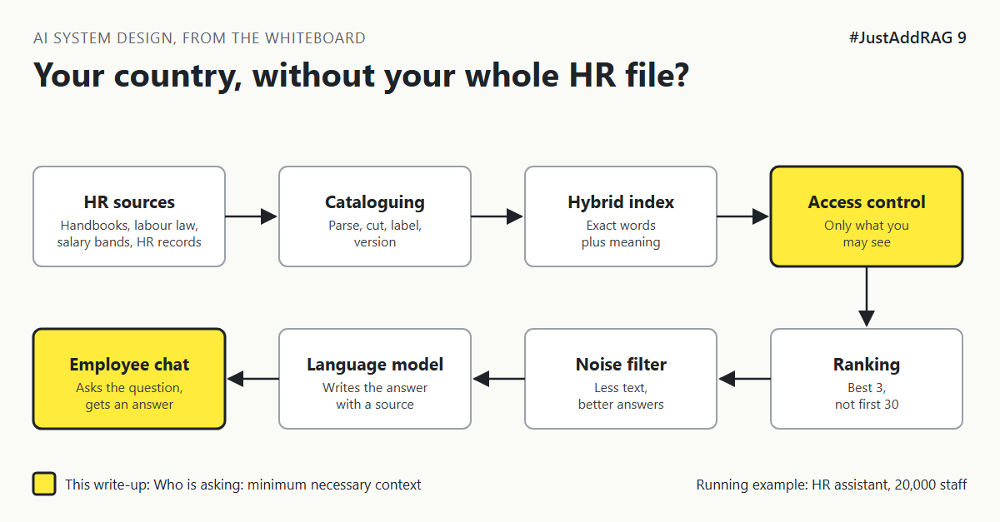

# 9. How Does The Assistant Know Your Country Without Knowing Too Much? | "It should know where I work and what my grade is."



*#JustAddRAG series: write-up 9 of 10*

"It should know where I work and what my grade is. I shouldn't have to tell it."

Fair. An employee asks the HR assistant: "What is my notice period?"

The honest answer is "it depends": on country, on contract type, on length of service, sometimes on grade. Without those facts, the assistant either asks five follow-up questions or guesses. Both are bad.

So someone suggests: "Just load the HR records into the index too. Then it knows everything."

That is how a helpful assistant becomes a privacy incident.

## The librarian who knows your membership, not your diary

A good library knows a few things about you: your membership type, your home branch, perhaps your preferred language. That is enough to point you to the right shelf and the right local edition.

It does not keep a copy of your diary, your bank statements and your medical notes on the open shelves, just in case they help with a recommendation.

The assistant needs the same idea: **minimum necessary context**. A handful of facts about the person asking, fetched when they ask, used mainly to choose the right documents.

## The options

**Option A: Put personal records in the search index.** Employee records become chunks like any other document.

**Option B: Fetch a small profile at question time.** When someone asks, look up a few fields from the HR system of record: country, work location, contract type, grade band, start date. Use them as search filters and as short facts in the prompt.

**Option C: Let the model ask the HR system itself.** Give the model a tool it can call, such as "get my leave balance", and let it decide when to use it.

| Option | Good at | Bad at | Pick it when |
|---|---|---|---|
| A. Personal records in the index | Simple to build on the demo | Copies personal data into a new store, search can match other people's records, hard to delete | Never for HR records |
| B. Small profile at question time | Precise filters, little data exposed, always current | Needs a reliable HR system API, a few more milliseconds | Most questions: policy that depends on who you are |
| C. Model calls HR tools | Answers personal questions like "how many days do I have left?" | More moving parts, needs tight permissions on every tool | Questions about the person's own live data |

## What I would pick, and why

Option B for every question, plus a small set of Option C tools for questions about the employee's own live data.

The profile does most of its work *before* the model sees anything. Country and contract type become filters (write-ups 4 and 7), so the German part-time rule is retrieved and the US full-time rule is not. The model then gets a short line: "Employee: Germany, part-time, joined 2021." Nothing else.

For live personal data like leave balances, a tool calls the HR system **as the employee**, so the HR system's own rules decide what comes back. How that identity is passed safely is covered in #DefendingAI, and how to keep tool-using assistants on a leash is covered in #AgenticAI.

On risk, the less personal data that enters prompts and logs, the smaller the review with privacy, legal and works councils, and the smaller the damage if something goes wrong.

## What would change my mind

- If the HR platform offers its own assistant that already answers personal questions safely, connect to it instead of rebuilding.
- If questions turn out to be almost entirely about general policy, the profile can shrink to just the country.

## How it fails

- **Over-sharing in prompts:** the whole employee record goes into every question.
- **Logs as a leak:** prompts with personal data are stored for months in a debugging tool.
- **Someone else's record:** search in Option A returns a colleague's data that matches the question.
- **Stale profile:** an employee moved country last month and still gets old-country answers.

## Rough numbers

| Item | Estimate |
|---|---|
| Profile fields needed | 5 to 8 [CHECK: map against your top questions] |
| Profile lookup time | Tens of milliseconds, less if briefly cached [CHECK] |
| Profile tokens in the prompt | Under 50 [CHECK] |
| Share of questions needing live personal data | Unknown until measured [CHECK: sample real questions] |

## Words to know

- **Minimum necessary context:** only the personal facts the answer needs.
- **System of record:** the authoritative source, here the HR system.
- **Tool call:** the model asking a trusted system for data through a defined function.
- **Data minimisation:** a privacy principle, collect and use only what is needed.

## Take this to your next design review

1. List the five facts that change most answers, and fetch only those.
2. Use personal facts as filters first, and as prompt text second.
3. Check what your logs store, and for how long.

Know enough about the person to find the right rule, and nothing more.

Next write-up (10): *What Does Enterprise RAG Look Like On One Whiteboard?*

Follow me for the next one.

Where do you draw the line on personal data in AI assistants? Tell me in the comments.

*New to the series?* Start with write-up 1: *Why Does "Just Add RAG" Sound Like 2 Weeks But Take 6 Months?* [Pending Publish]

---

*Post text (copy and paste):*

```
"It should know where I work and what my grade is."
"What is my notice period?" depends on country, contract and service.
Someone suggests loading all HR records into the index.

That is how a helpful assistant becomes a privacy incident.

#JustAddRAG, write-up 9: minimum necessary context.
Where is your line?
#AI #SystemDesign #RAG #Privacy #JustAddRAG
```

*Series index (post as the first comment, then pin it):*

```
📌 #JustAddRAG
1. Why Does "Just Add RAG" Sound Like 2 Weeks But Take 6 Months? [Pending Publish]
2. What Actually Happens To A PDF Before The Assistant Can Read It? [Pending Publish]
3. How Small Can You Cut A Policy Before It Stops Making Sense? [Pending Publish]
4. Why Does The Assistant Find "Parental Leave" But Miss "HR-PL-204"? [Pending Publish]
5. Why Is The First Search Result So Often Not The Best One? [Pending Publish]
6. How Do You Stop A Salary Band Reaching The Wrong Screen? [Pending Publish]
7. Which Copy Of The Leave Policy Is The True One? [Pending Publish]
8. Why Does Giving The Model More Text Make The Answer Worse? [Pending Publish]
9. How Does The Assistant Know Your Country Without Knowing Too Much? [Pending Publish] (you're here)
10. What Does Enterprise RAG Look Like On One Whiteboard? (next)
```
