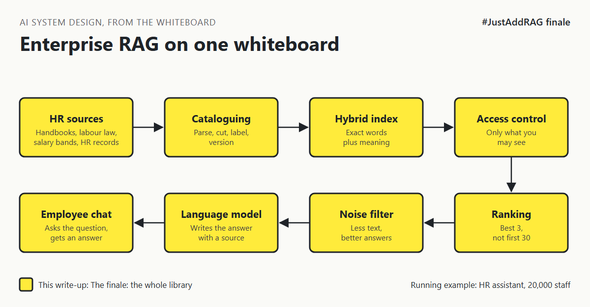

# 10. What Does Enterprise RAG Look Like On One Whiteboard? | "Show me the whole thing on one page before we fund it."



*#JustAddRAG series: the finale*

"Show me the whole thing on one page before we fund it."

Nine write-ups ago, the whiteboard had three boxes: documents, a vector database, a chat window. It looked finished.

Here is the same whiteboard after asking the questions demos skip, for the HR assistant serving 20,000 staff.

## The whole library, on one page

There are two journeys through the system.

**The catalogue desk (runs when documents change):**

1. **Find and fingerprint** documents in the places HR publishes them. Skip duplicates. Notice deletions. (write-up 2)
2. **Parse** with layout-aware tools, so tables stay tables. (write-up 2)
3. **Label** every document: country, version, effective dates, precedence, access groups. (write-ups 2, 6, 7)
4. **Cut** into chunks along headings, with the heading path attached. (write-up 3)
5. **Index** for both exact words and meaning. (write-up 4)

**The reading room (runs on every question):**

1. **Know who is asking:** a small profile and their groups, fetched now. (write-ups 6, 9)
2. **Filter** by access, country and date, before anything is ranked. (write-ups 6, 7)
3. **Search** by keywords and meaning, then merge. (write-up 4)
4. **Rerank** the shortlist down to the best few. (write-up 5)
5. **Assemble** a small, labelled context within a budget. (write-up 8)
6. **Answer** with sources, and call the HR system for the employee's own live data. (write-up 9)

The demo built step 6 of the reading room and step 5 of the catalogue desk. Everything else is the hidden part of the library.

## One table for the design review

| Box | Default choice | Change it when |
|---|---|---|
| Parsing | Layout-aware, vision model as fallback | Content is plain prose or already structured |
| Labels | Fixed metadata record from day one | Never postpone this one |
| Chunking | By heading, small for search and big for reading | Content is short FAQ entries |
| Search | Hybrid with rank fusion | Real queries have no codes or names |
| Reranking | Cross-encoder, 50 down to about 5 | Search already ranks the answer first |
| Access | Filter during search, default deny | Two audiences that never overlap |
| Versions | Effective dates and country precedence as data | One country, no future-dated policies |
| Context | Token budget, best passage first | Questions need whole documents |
| Personal data | Small profile, own-data tools act as the user | HR platform already does it safely |

## The build order

1. Catalogue and labels.
2. Hybrid search with access and country filters.
3. Reranking and the context budget.
4. Profile and own-data tools.
5. Measurement of answer quality, before launch (that is a series of its own: #AIEvalEngine).

The order matters because the first item is the only one that forces every document to be processed again if you get it wrong. For a sponsor, that is the real answer to "why 6 months": the money is modest, but the calendar is set by labels, permissions and country owners, so fund those people's time first.

## What would change my mind about building at all

If the HR platform you already pay for offers an assistant that respects its own permissions, covers your countries and cites its sources, buy it and spend the six months elsewhere. This series is still the checklist for judging it.

[MY STORY: one decision from a real RAG project you would make differently with this whiteboard in hand]

## Take this to your next design review

1. Draw both journeys, the catalogue desk and the reading room, before discussing any product.
2. Get the labels right first: country, version, dates, access.
3. Ask for numbers on every box: time, tokens and owner.

The model is the one part of a RAG system you can rent; the library around it is the part you have to build.

That is the end of #JustAddRAG. Thank you for reading all ten.

Next series: *#ModelRouting*. The HR assistant now uses one expensive model for "hello", "thanks" and German labour law alike. Why does the head chef chop the onions?

Follow me for the next one.

Which box on this whiteboard has cost your team the most time? Tell me in the comments.

*New to the series?* Start with write-up 1: *Why Does "Just Add RAG" Sound Like 2 Weeks But Take 6 Months?* [Pending Publish]

---

*Post text (copy and paste):*

```
"Show me the whole thing on one page before we fund it."
Nine write-ups ago it was three boxes on a whiteboard.
Now it is a catalogue desk and a reading room.

Here is enterprise RAG on one page.

#JustAddRAG finale: the full architecture and build order.
Which box cost you most?
#AI #SystemDesign #RAG #EnterpriseAI #JustAddRAG
```

*Series index (post as the first comment, then pin it):*

```
📌 #JustAddRAG
1. Why Does "Just Add RAG" Sound Like 2 Weeks But Take 6 Months? [Pending Publish]
2. What Actually Happens To A PDF Before The Assistant Can Read It? [Pending Publish]
3. How Small Can You Cut A Policy Before It Stops Making Sense? [Pending Publish]
4. Why Does The Assistant Find "Parental Leave" But Miss "HR-PL-204"? [Pending Publish]
5. Why Is The First Search Result So Often Not The Best One? [Pending Publish]
6. How Do You Stop A Salary Band Reaching The Wrong Screen? [Pending Publish]
7. Which Copy Of The Leave Policy Is The True One? [Pending Publish]
8. Why Does Giving The Model More Text Make The Answer Worse? [Pending Publish]
9. How Does The Assistant Know Your Country Without Knowing Too Much? [Pending Publish]
10. What Does Enterprise RAG Look Like On One Whiteboard? [Pending Publish] (you're here)
Next series: #ModelRouting (next)
```
