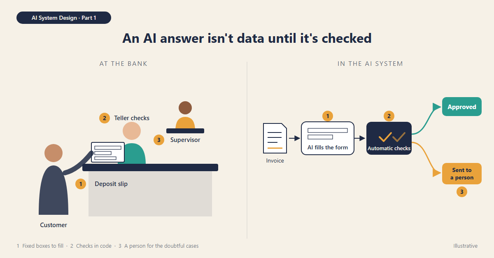

# Same Invoice, Two Different Totals

*AI System Design: From Real-World Problems to Production-Ready Solutions · Part 1*

> Status: Draft for review · ~550 words · Contoso is a fictional company; the scenario is illustrative

---

The demo went perfectly.

Contoso's finance team gave an AI tool twenty supplier invoices. For each one it picked out the supplier, the date and the total. Everyone was impressed.

Then the real pilot started, and three strange things happened.

1. One invoice came back as a sentence: *"The total is about 4,500, I think."* The accounting system needed a number, not a sentence.
2. The same invoice, run twice, gave **two different totals**.
3. An invoice with no order number came back *with* one. It looked real. It was made up.

The AI wasn't broken. We had simply misunderstood what it does.

## Why this happens

An AI model doesn't look up answers. It writes them, one word at a time, choosing words that sound right. That's why it's so good with language.

But "sounds right" isn't the same as "is right". A finance process needs exact numbers, every time.

## An everyday example: the bank deposit slip

Imagine walking into a bank and saying, *"Put about four and a half thousand into my savings, the account ending 72, I think."*

The bank won't accept that. It gives you a **deposit slip** with fixed boxes: account number, amount, date. Then a **teller checks it**. Does the amount in figures match the amount in words? Does the account exist? If anything looks odd, a **supervisor** takes a look.

A good AI system works the same way:

- **The slip:** the AI must fill in fixed boxes, not write free text.
- **The teller:** simple checks run automatically. Do the line items add up to the total? Does this order number really exist in our system? Has this invoice already been paid?
- **The supervisor:** anything that fails a check goes to a person.

One small detail matters a lot. We had made the order-number box *mandatory*, so the AI filled it even when there was nothing to fill. If "not on the invoice" is an allowed answer, the AI can say so honestly instead of inventing a number.

**Where the comparison breaks down:** a teller can count the cash. Our checks can catch numbers that don't add up, but not every wrong number. That is why the person at the end still matters.

## What this means for the business

The goal was never "use AI". It was **faster invoice processing without weakening financial controls**.

With this design:

- AI does the slow part: reading messy documents.
- The checks finance already trusts stay in place, and auditors can see them.
- People only look at the invoices that need attention.

Before anyone claims success, measure it. What share of invoices go through with no human touch? How many errors are caught before payment? What does each invoice cost to process?

## Key takeaway

An AI answer isn't business data until it has been checked. Give it fixed boxes to fill, check what it writes, and let a person handle the doubtful cases.

**Over to you:** where in your company does AI output go straight into a system that expects exact values?

*For the engineers: use structured outputs (a JSON schema) and validate in code anyway. Make missing fields nullable. Setting temperature to 0 doesn't guarantee the same output every time.*

---

## Supporting visual (not part of the post)

**Ready to use:** [images/01-same-invoice-two-totals.png](images/01-same-invoice-two-totals.png) (1200 × 627, the LinkedIn article cover size). Edit [images/01-same-invoice-two-totals.svg](images/01-same-invoice-two-totals.svg) to change it. The prompt below is an optional alternative if you want an AI-generated illustration instead.

**Concept:** Left, a customer hands a deposit slip to a bank teller, with a supervisor's desk behind. Right, an invoice flows through "AI fills the form", then "Automatic checks", then splits into "Approved" and "Sent to a person". Dashed lines link slip to form, teller to checks, supervisor to person.

**Image-generation prompt:**

> Flat editorial illustration, landscape 1200x627, warm off-white background (#F6F1E7), navy line work (#1F2A44), teal (#2A9D8F) and amber (#E9A23B) accents, minimal shading, simple sans-serif labels. LEFT: a bank counter; a customer hands a paper deposit slip with boxed fields to a friendly teller; a small supervisor desk behind. RIGHT: a simple left-to-right flow: an invoice icon, a box labelled "AI fills the form", a gate with a check mark labelled "Automatic checks", then two arrows: teal "Approved" and amber "Sent to a person". Thin dashed lines link the slip to the form, the teller to the checks, the supervisor to "Sent to a person". Small tag top-left "AI System Design · Part 1". No robots, no glowing brains, no logos.

## References

1. Thinking Machines Lab, *Defeating Nondeterminism in LLM Inference*, September 2025. Shows the same prompt can give different answers even at temperature 0. https://thinkingmachines.ai/blog/defeating-nondeterminism-in-llm-inference/
2. Microsoft Learn, *Request a response with structured output* (.NET). https://learn.microsoft.com/dotnet/ai/quickstarts/structured-output
