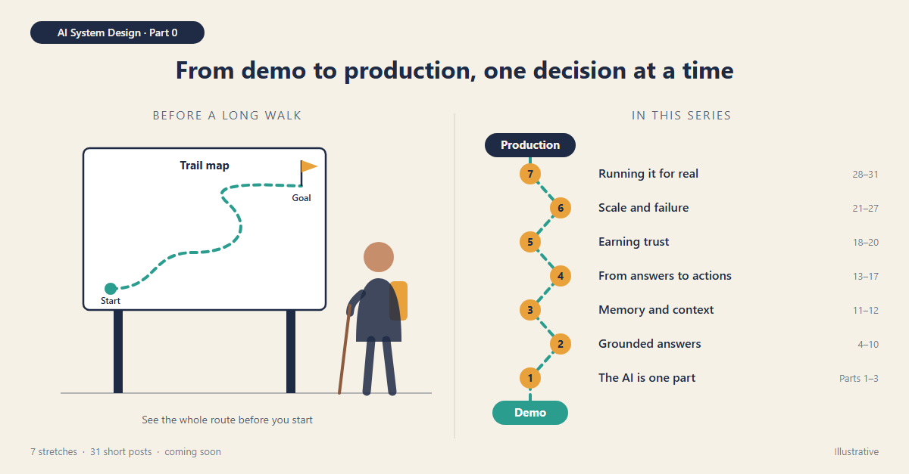

# The Demo Worked. Now What?

*AI System Design: From Real-World Problems to Production-Ready Solutions · Part 0 (curtain raiser)*

> Status: Draft for review · ~480 words · Introduces the series. No facts or figures to check.

---

Most AI projects I see start the same way. Someone builds a demo in an afternoon. It answers questions, summarises documents and drafts emails. Everyone is impressed.

Then the real questions begin:

- Why did it give a different answer this time?
- Why is it so slow on Monday mornings?
- Can it see documents this person isn't allowed to see?
- What happens when the AI provider is down?
- And why did the bill triple?

None of these is really a question about the AI model. They are questions about **the system around it**. That's what this series is about.

## What to expect

Over the coming weeks, I'll share 31 short posts, one at a time. Each post:

- starts with a business problem at **Contoso**, a made-up company, so no example is mistaken for a real incident,
- explains it with an everyday comparison, like a bank teller, a doctor's file or a travel desk,
- shows the simple fix and what it means for the business,
- ends with one line for engineers who want the technical names.

No code. No hype. Plain words.

## The route

Before a long walk, you look at the trail map. Here's ours, in seven stretches:

1. **The AI is one part, not the whole product** (Parts 1 to 3)
2. **Answers based on what your company knows** (Parts 4 to 10)
3. **What the AI remembers, and what it sees** (Parts 11 and 12)
4. **From answering to acting:** AI that uses tools and takes steps (Parts 13 to 17)
5. **Earning trust:** testing and security (Parts 18 to 20)
6. **Designing for scale and failure:** requirements, quick capacity maths, scaling up and down, staying available, recovering from outages, deploying safely (Parts 21 to 27)
7. **Running it for real:** speed, monitoring, cost, and the full picture (Parts 28 to 31)

By the last post we'll have drawn one complete architecture, one decision at a time.

## Who it's for

- **Business leaders** deciding where AI fits and what it will cost.
- **Product managers** who want to ask the right questions early.
- **Engineers and architects** taking AI from demo to production.

## A promise

Every number will be cited, taken from my own project work, or clearly marked as an example. If something is hypothetical, I'll say so.

## Key takeaway

The AI model is the easy part. The system around it decides whether people can trust it.

**Over to you:** what's the one question about AI in production you'd most like answered? I'll fold the best ones into the series.

*For the engineers: the series covers structured output and validation, context engineering, LLM gateways, RAG with permission-aware retrieval, agents with tools, MCP and durable execution, evaluation, prompt-injection defence, non-functional requirements, capacity estimation, scaling, availability and disaster recovery, CI/CD for prompts and models, multi-tenancy, observability and cost, with .NET and Azure examples.*

---

## Supporting visual (not part of the post)

**Ready to use:** [images/00-the-demo-worked-now-what.png](images/00-the-demo-worked-now-what.png) (1200 × 627, the LinkedIn article cover size). Edit [images/00-the-demo-worked-now-what.svg](images/00-the-demo-worked-now-what.svg) to change it.

**Concept:** Left, a hiker studying a trail map at the start of a walk. Right, the series as a route climbing from "Demo" to "Production", with seven numbered stops, one for each arc.

**Image-generation prompt (optional alternative):**

> Flat editorial illustration, landscape 1200x627, warm off-white background (#F6F1E7), navy line work (#1F2A44), teal (#2A9D8F) and amber (#E9A23B) accents, minimal shading, simple sans-serif labels. LEFT: a hiker with an amber backpack and a walking stick studies a trail-map signboard showing a winding dashed path from "Start" to a flag. RIGHT: a dashed teal route climbing from a pill labelled "Demo" at the bottom to a navy pill labelled "Production" at the top, with seven numbered amber stops labelled "The AI is one part", "Grounded answers", "Memory and context", "From answers to actions", "Earning trust", "Scale and failure", "Running it for real". Small tag top-left "AI System Design · Part 0". No robots, no brains, no logos.

## References

None needed: this post introduces the series and makes no factual claims.
